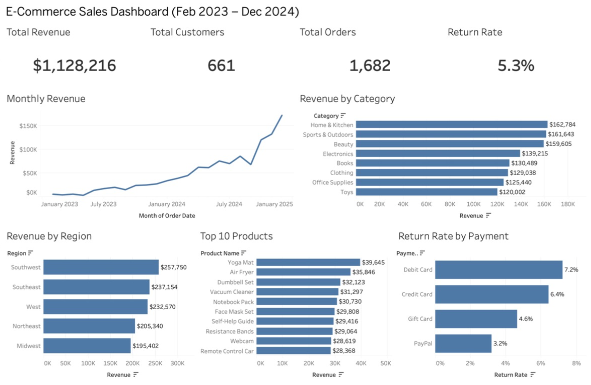

# E-Commerce Sales Dashboard (Tableau)

An interactive sales dashboard built in Tableau Public from an e-commerce dataset of 1,682 orders (Feb 2023 – Dec 2024). The data is prepared with SQL in PostgreSQL, then visualized to answer the questions a sales manager would ask.

**[View the live interactive dashboard on Tableau Public](https://public.tableau.com/app/profile/pdhruv15/viz/E-CommerceSalesDashboard_17924822464680/SalesDashboard)**



**Tools:** PostgreSQL · SQL · Tableau Public

---

## Business Questions

| # | Question | Visual |
|---|---|---|
| 1 | How is the business doing overall? | KPI cards: revenue, customers, orders, return rate |
| 2 | Is revenue growing? | Monthly revenue line chart |
| 3 | Which product categories sell most? | Revenue by category |
| 4 | Which regions are strongest? | Revenue by region |
| 5 | What are the best-selling products? | Top 10 products by revenue |
| 6 | Where are returns concentrated? | Return rate by payment method |

---

## Key Insights

- **Strong growth:** monthly revenue grew from about $5K in early 2023 to $173K in December 2024. 2024 revenue ($969K) was about 6x 2023 ($159K).
- **Holiday peak:** Q4 2024 (Oct–Dec) alone produced $426K, about 38% of all revenue in the dataset.
- **Balanced categories:** revenue is spread evenly across all 8 categories; the top (Home & Kitchen, $163K) is only about 36% above the lowest (Toys, $120K).
- **Regional gap:** the Southwest leads with $258K (23% of revenue); the Midwest trails at $195K (17%), a potential target for regional marketing.
- **Returns by payment method:** debit card orders are returned at 7.2%, more than double PayPal's 3.2%. Overall return rate is 5.3% (89 of 1,682 orders).

---

## How It Was Built

### 1. Data preparation (SQL)
The source data lives in four PostgreSQL tables (customers, orders, order_items, products) from my [database design project](https://github.com/Pdhruv1512/ecommerce-postgres-dba). Tableau works best with one flat table, so [`sql/01_sales_view.sql`](sql/01_sales_view.sql) creates a view that:

- joins the four tables so each row is one product in one order
- calculates `revenue = quantity × unit_price`
- converts `is_returned` from true/false to 1/0 so return rates can be calculated
- filters out 1 million synthetic test rows used for performance testing in the database project, keeping only the real 4,183 order items

The view is exported to [`data/sales.csv`](data/sales.csv):

```bash
psql ecommerce -f sql/01_sales_view.sql
psql ecommerce -c "\copy (SELECT * FROM sales ORDER BY order_item_id) TO 'data/sales.csv' WITH (FORMAT csv, HEADER true)"
```

### 2. Validation
Before building charts, the Tableau total was checked against SQL: both report **$1,128,216** in revenue, confirming the data imported correctly.

### 3. Dashboard (Tableau)
- **Return Rate** is a calculated field measured per order, not per row, so orders with several products are not counted multiple times:
  ```
  COUNTD(IF [Is Returned] = 1 THEN [Order Id] END) / COUNTD([Order Id])
  ```
- Orders and customers use **Count Distinct** for the same reason.
- **Interactive filtering:** clicking a bar in *Revenue by Region* or *Revenue by Category* filters every other chart and KPI on the dashboard, so a manager can focus on one market or product line. For example, selecting the Southeast shows $237K revenue and a 12.9% debit card return rate.

---

## Project Structure

```
├── sql/
│   └── 01_sales_view.sql   # Joins tables into one flat view for Tableau
├── data/
│   └── sales.csv           # Exported dataset (4,183 rows)
├── images/
│   └── dashboard.png       # Dashboard screenshot
└── README.md
```
